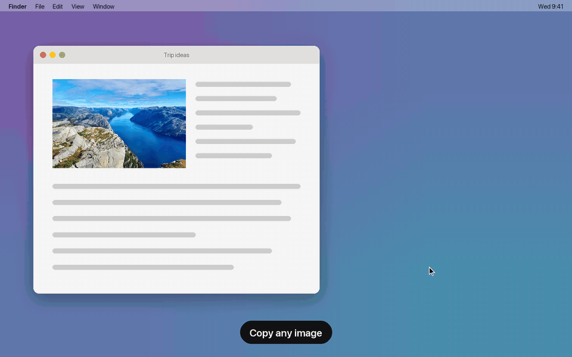

# Floater



## Install

Needs macOS 14+ and the Xcode command line tools (`xcode-select --install`).

```sh
git clone https://github.com/tomatosource/floater && cd floater
make install   # installs /Applications/Floater.app
```

Then copy an image and open Floater. Hover it for the controls (each has a tooltip); click it and
press ⌘Q to quit.

Or paste this to your coding agent (Claude Code or similar):

> Install Floater from https://github.com/tomatosource/floater: clone it, run `make install`, then
> install its `SKILL_EXAMPLE.md` as a skill named `floater` (for Claude Code,
> `~/.claude/skills/floater/SKILL.md`) so you can show me images in it.

## Scripting and agents

This repo includes an example agent skill, [`SKILL_EXAMPLE.md`](SKILL_EXAMPLE.md), that lets an agent
float images ("show me…"), read the floated image, and switch modes. It uses the two hooks below.

**Switch modes** on the running window with a URL:

```sh
open -g floater://big      # big mode
open -g floater://small    # small mode
open -g floater://toggle   # big mode unless it already is, else small mode
open -g floater://pin      # show on every desktop
open -g floater://unpin    # show on the current desktop only
```

`-g` leaves focus where it is. Only use these while Floater is running: if it isn't, the URL
launches it, floating whatever is on the clipboard.

**Set the image** without touching the clipboard: write it to
`~/Library/Application Support/Floater/last.png` (or `last.gif` to keep a GIF animated; Floater
shows whichever is newer, so delete the other), then relaunch with `--restore`. The new instance
replaces the running one, keeping the window's position and area, reshaped to the new image.

```sh
cp image.png ~/Library/Application\ Support/Floater/last.png
rm -f ~/Library/Application\ Support/Floater/last.gif
open -n -a Floater --args --restore
```

## Development

```sh
make build      # build build/Floater.app
make run        # build and launch, floating the image on the clipboard
make dev        # rebuild and relaunch, restoring the last image, position and size
make watch      # `make dev` on every source change (needs entr: brew install entr)
make install    # build and copy to /Applications
make uninstall  # remove /Applications/Floater.app
make demo       # re-render docs/demo.gif (see docs/demo/GUIDE.md)
make clean      # remove build output
```

## Credits

Demo photos from Unsplash, credited in [`docs/demo/assets/CREDITS.md`](docs/demo/assets/CREDITS.md).
Icons from [Lucide](https://lucide.dev) (ISC).
