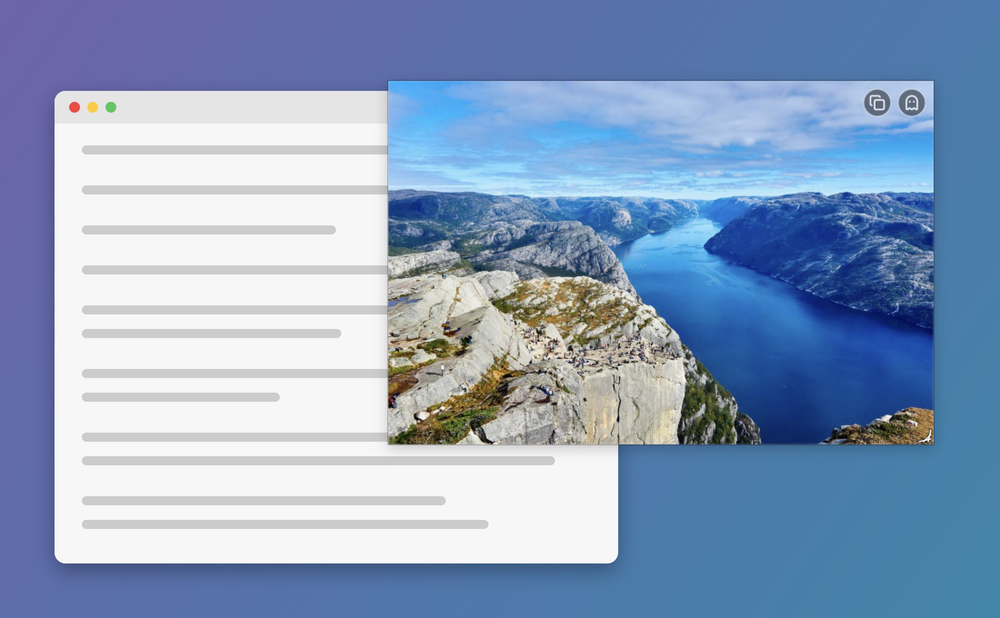

# Floater

Floats the image (or animated GIF) on your clipboard in a frameless, draggable, resizable, always-on-top window on the current desktop.



## Install & use

Needs macOS 14+ and the Xcode command line tools (`xcode-select --install`).

```sh
git clone https://github.com/tomatosource/floater && cd floater
make install   # installs /Applications/Floater.app
```

With an image or GIF on your clipboard, open Floater. Click it and press ⌘Q to close.

Hover and click **A** to make it big, **B** to tuck it small into the top-right corner. Prefer a
different small spot? Put it there and double-click **B**; triple-click **B** to go back to the default.

## Features

- Opens centred on the screen with the mouse. If there's no image on the clipboard it reopens the
  last image where it was (or, with no last image, opens on a random photo; if that fetch fails it
  posts "No image on clipboard" and quits).
- Click the window and press ⌘V to replace the image with the one on the clipboard (keeps the
  window's centre and area; beeps if there's no image).
- Launching it again closes the running copy (re-opening a running copy reloads from the clipboard).
- Not in Cmd+Tab or the Dock (`LSUIElement`). Click the image to focus, Cmd+Q to quit.
- Drag the image to move. Drag any corner to resize (aspect ratio kept). Only the bottom-right
  corner shows a grip; the other corners are invisible hot zones with a resize cursor.
- Animated GIFs play — copied GIF data (e.g. from a browser) or a `.gif` file copied in Finder.
- On hover, a strip of buttons in the top-right corner, left to right:
  - **A** — big: as large as fits the screen (aspect kept, at least 20px clear of the menu bar,
    Dock and screen edges), centred.
  - **B** — small: by default in the top-right corner (20px in), its longer side ~22% of the
    screen's longer side. Double-click to save the window's current position and size as B
    instead (a different-shaped image keeps the saved centre and width); triple-click to clear
    that and go back to the default. The saved spot persists across launches (`slotB` default).
  - A and B animate the move, so clicking them toggles between big and small.
  - **Eraser** replaces the image with a random photo from [Lorem Picsum](https://picsum.photos)
    (Unsplash photos, free to use, no API key); the window keeps its centre and area.
  - **Copy** the image to the clipboard (GIFs keep their animation).
  - **Ghost** toggles image transparency (100% / 40%; the controls stay opaque).

  Icons are [Lucide](https://lucide.dev) SVGs embedded in `Icon`.

## Development

```sh
make build      # build build/Floater.app
make run        # build and launch, floating the image on the clipboard
make dev        # rebuild and relaunch, restoring the last image, position and size
make watch      # `make dev` on every source change (needs entr: brew install entr)
make install    # build and copy to /Applications
make uninstall  # remove /Applications/Floater.app
make clean      # remove build output
```

The whole app is `Sources/Floater/main.swift`; `build.sh` wraps the SwiftPM binary in an ad-hoc
signed `.app` bundle.

The app saves its current image to `~/Library/Application Support/Floater/last.png` (or `last.gif`
for a GIF; whichever is newer wins) and its window frame to the `lastFrame` user default (bundle
`com.tomatosource.floater`) every time it shows, moves or resizes. Launching with `--restore`
(what `make dev` does) reads these instead of the clipboard. Keep this working when changing how
windows are created.

**Note for agents:** relaunch with `make dev`, never a plain `open` or `make run`. The user may
have the window placed somewhere deliberately, and their clipboard has likely moved on.

## Credits

Screenshot photo by [Alexey Topolyanskiy](https://unsplash.com/photos/-oWyJoSqBRM) on Unsplash.
Icons from [Lucide](https://lucide.dev) (ISC).
